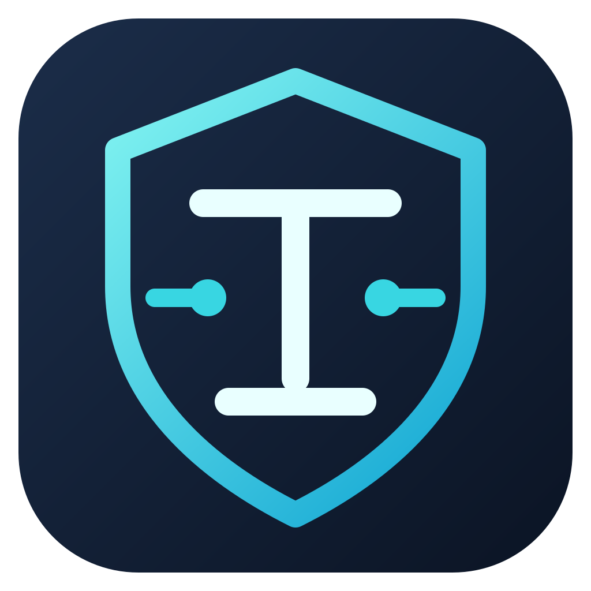

# IT Toolkit by Roden Segas



**v1.0.0 — Initial Public Release**  
**Copyright © 2026 Roden Segas. All rights reserved.**

A portable Windows helpdesk and administration utility built with **C#, WPF, MVVM and .NET Framework 4.8**. It brings common diagnostic evidence, selected maintenance operations, online software installation and reports into one dark desktop interface.

The project addresses repeated support work: gathering system evidence, checking network connectivity, finding service or event problems, running supported Windows repairs with live output, and verifying whether requested software changes actually occurred.

This initial public version continues the existing internal v3.1.2 codebase. It is an incremental maintenance and packaging release, not a framework migration.

## Modules

| Module | Capabilities |
| --- | --- |
| Dashboard / System Information | Asynchronous hardware, operating-system and resource inventory |
| Network Diagnostics | Ping, DNS and TCP checks; advanced adapter evidence and explicit DHCP/DNS repair actions |
| Advanced Diagnostics | Automatic cached category collection; storage, devices, BIOS/drivers, domain, reboot and performance evidence; installed-software inventory and selected-app uninstall |
| Services & Events | Searchable service table with applicable actions; selected-log event filters, bounded pages and complete event details |
| Windows Maintenance | SFC/DISM live output, state-aware NetFx3 enablement, GPResult and interactive local GPUpdate |
| Remote Group Policy | Explicitly enabled, authorized RSAT/current-identity GPUpdate; submission distinguished from completion |
| Windows Update | Native Settings integration, read-only diagnostics/optional availability scan and verified download-only Lenovo/Dell utility actions |
| Software | Official direct catalog installers, explicit optional WinGet provider and independent identity/version checks |
| Reports | Selected-section HTML/JSON, software CSV/JSON and privacy redaction enabled by default |

There is no PowerShell-based GUI, embedded shell console, organizational Office deployment, custom update installation engine, or bundled vendor installer. Optional remote policy management uses built-in Windows PowerShell 5.1/RSAT; ordinary startup does not execute PowerShell.

## Portable use

Download **IT-Toolkit-Roden-v1.0.0-portable.zip**, extract it to a clean local NTFS directory and double-click **IT-Toolkit-Roden.exe**. Keep its exact **IT-Toolkit-Roden.exe.config** beside it. A shortcut or installation is unnecessary. Settings / About offers an optional **Create my desktop shortcut** action; nothing is created on other PCs automatically.

```text
IT-Toolkit-Roden/
  IT-Toolkit-Roden.exe
  IT-Toolkit-Roden.exe.config
  docs/
  assets/
```

The ZIP marks the config Hidden. Some extractors do not preserve this attribute; visibility does not affect functionality. The adjacent config is a CLR requirement and must not be moved. Documentation, license notices and checksums are under docs. Visual assets are also embedded, so the GUI does not load loose XAML or logos at startup.

**Prerequisites:** Windows 11 x64 / Windows desktop with .NET Framework 4.8 compatibility, a local NTFS location for elevated operations, appropriate Windows permissions and network access for online actions. Organizational restrictions remain authoritative. No PowerShell 7 or third-party runtime is required.

## Safe operations and evidence

Configuration actions follow **Check → Decide → Execute → Verify**. Known desired states skip redundant actions; unavailable evidence is never interpreted as healthy. Unknown latest software versions are reported as **Installed — Update Status Unknown**, not Up to Date. Native exit codes alone do not establish installation/removal/repair success.

Selected-app uninstall rereads its exact hive/view/key, confirms name/publisher/version, rejects protected components and unsupported commands, then invokes only the registered interactive uninstaller. MSI removal is product-code scoped; EXE arguments are preserved rather than made silent. Fresh registry inventory determines the result. Protected/unsigned/ambiguous registrations may require Windows Installed apps instead. The toolkit never authorizes reboot/logoff; vendor prompts remain the user's responsibility.

Normal startup uses an **asInvoker** manifest. Fixed privileged maintenance/install operations run in a separate same-image helper authenticated over a restricted local named pipe. The helper does not accept arbitrary command strings, downloaded paths or uninstall commands. Registered uninstallers launch through Windows separately, with elevation requested only for machine scope when required. See [Security](Security.md).

## Technology and implementation

- C# 5, native WPF, MVVM and INotifyPropertyChanged; explicit binding modes for read-only values.
- .NET Framework 4.8 assemblies only; no NuGet application runtime dependencies.
- WMI, Windows Registry, Event Log APIs, networking APIs and native Win32 security/MOTW/trust APIs.
- Task-based asynchronous work, bounded provider slots, cancellation checkpoints and actual stdout/stderr streaming.
- Structured JSONL logging, protected staging, signature/hash checks and independently refreshed installation evidence.
- Embedded XAML/theme/icon/logo; local portable executable plus its CLR config.

## Build and testing

Source release: **IT-Toolkit-Roden-v1.0.0-source.zip**. Open IT-Toolkit-Roden.sln with Visual Studio or use MSBuild with the .NET desktop build tools and Framework 4.8 Developer Pack:

```bat
MSBuild.exe IT-Toolkit-Roden.sln /t:Rebuild /p:Configuration=Release /p:Platform=x64 /m
artifacts\tests\Toolkit.Tests.exe --process --windows
```

Where normal development policy permits scripts, `Build.ps1 -RunWindowsFixtures` also builds, tests and packages both releases. No execution-policy change is needed or recommended. Detailed instructions: [Build](Build.md).

**Validation disclosure:** the supplied EXE is cross-compiled and the available automated tests run on Linux. Actual Windows GUI, UAC, installer, uninstaller, service and provider acceptance was not performed here. See [Test report](Test-Report.md), [Windows validation](Windows-Validation.md) and [limitations](Known-Limitations.md). The binary is unsigned; checksums establish integrity, not trusted publisher identity.

## Branding and screenshots

The original navy/cyan shield-and-circuit mark is supplied as editable SVG, high-resolution PNG and multi-resolution ICO. It is embedded in the executable/window and shown in Dashboard/About. No third-party logo is used.

Actual Windows screenshots have not been captured in this build environment. The Windows validation guide explains how to capture Dashboard, diagnostics and About from the real application without exposing device/account information. No mockup is presented as a tested GUI screenshot.

## Project attribution and notices

Created and maintained as **IT Toolkit by Roden Segas**. No employer affiliation, vendor endorsement or Windows validation certification is claimed. Existing MIT notices in [LICENSE](LICENSE) are retained for previously licensed material; [OWNERSHIP.md](OWNERSHIP.md) distinguishes those obligations from the project's branding and new material. [Third-party notices](THIRD-PARTY-NOTICES.md) cover framework and vendor rights. This release does not introduce a new public open-source license or remove existing license obligations.
